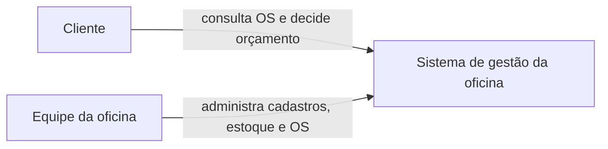
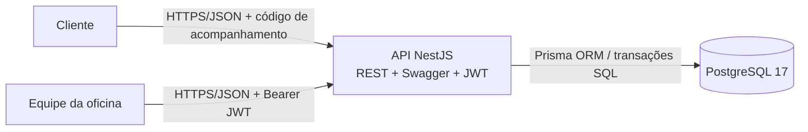
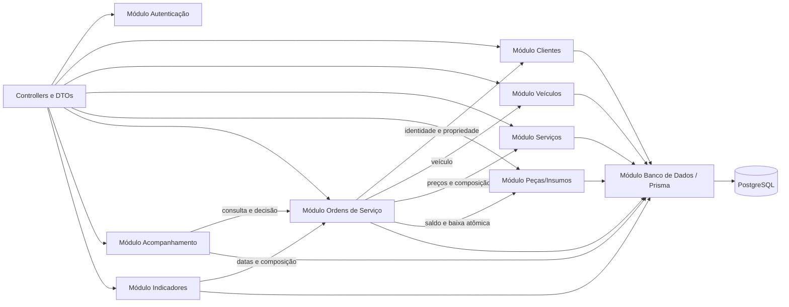

# Modelo C4 — Oficina Mecânica

Os diagramas representam o monólito modular implementado. Não há microsserviços, mensageria ou integração externa nesta fase.

## Nível 1 — Contexto

## Nível 2 — Contêineres

## Nível 3 — Componentes da API

## Mapeamento para o código

| Elemento | Implementação |
|---|---|
| Composição principal | `src/aplicacao.module.ts` |
| Interface HTTP | `src/modulos/*/apresentacao/` |
| Casos de uso e portas | `src/modulos/*/aplicacao/` |
| Modelo e regras | `src/modulos/*/dominio/` |
| Adaptadores | `src/modulos/*/infraestrutura/` |
| Persistência | `prisma/schema.prisma` e `src/banco-dados/` |
| Execução local | `Dockerfile` e `docker-compose.yml` |
