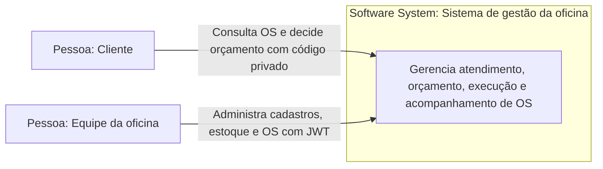
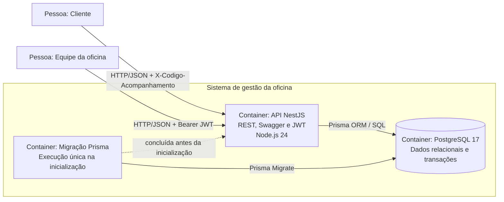
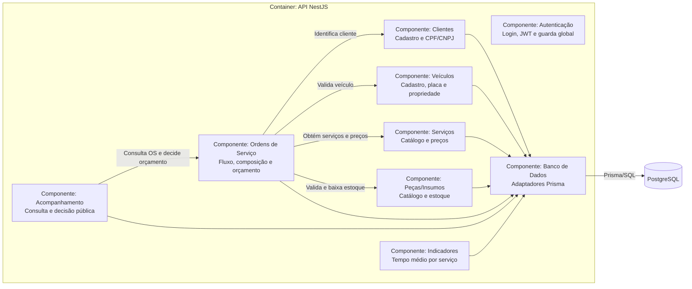
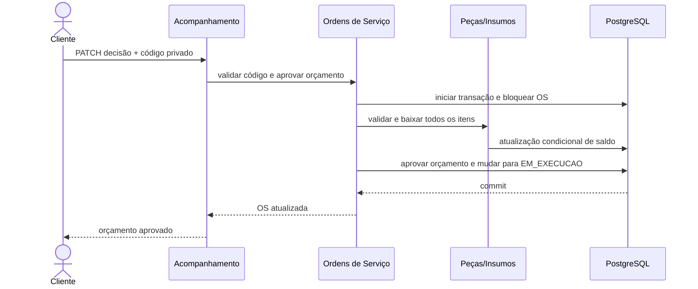
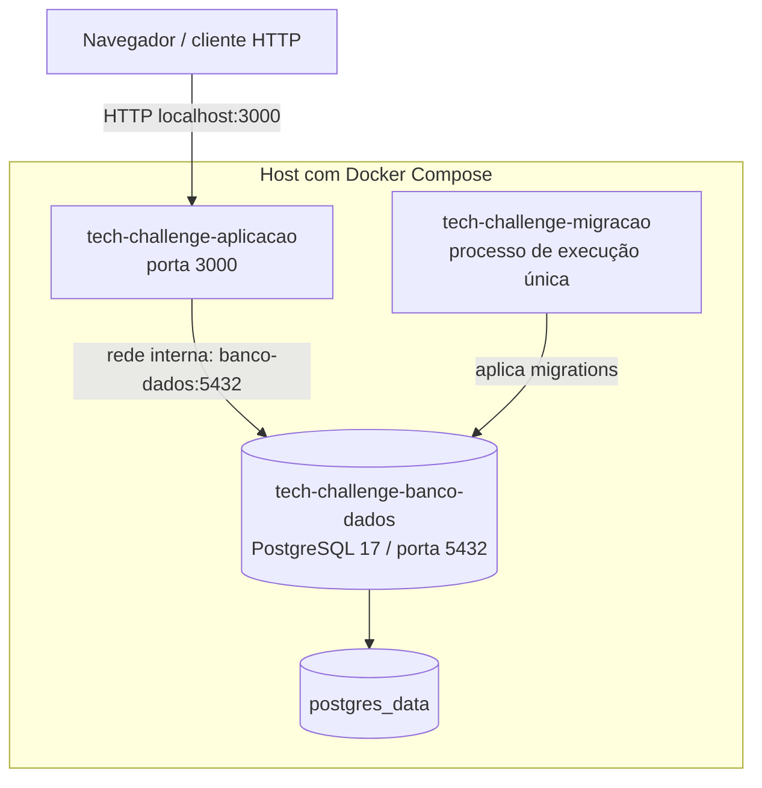

# Modelo C4 — Oficina Mecânica

## Objetivo e escopo

Os diagramas descrevem a arquitetura entregue na Fase 1. O sistema é um monólito modular executado em um único processo NestJS, sem front-end próprio, mensageria, microsserviços ou integrações externas. Os níveis seguem uma aproximação progressiva: contexto, contêineres e componentes.

## Nível 1 — Contexto do sistema (C1)

**Propósito:** permitir que a equipe da oficina administre clientes, veículos, catálogo, estoque e ordens de serviço, enquanto o cliente acompanha a própria OS e decide sobre o orçamento.

Não existem sistemas externos integrados nesta fase.

## Nível 2 — Contêineres (C2)

**Propósito:** mostrar as unidades executáveis e de armazenamento implantadas pelo Docker Compose.

| Contêiner | Responsabilidade | Tecnologia |
|---|---|---|
| API | Contrato REST, autenticação, casos de uso e regras de domínio | NestJS, TypeScript, Swagger e Prisma Client |
| Migração | Aplicar migrations versionadas antes da aplicação | Prisma Migrate |
| Banco de dados | Persistir entidades, composições, orçamentos e histórico da OS | PostgreSQL 17 |

## Nível 3 — Componentes da API (C3)

**Propósito:** apresentar os módulos de negócio que compõem o contêiner da API e suas dependências relevantes.

Cada módulo contém sua própria entrada HTTP em `apresentacao`, casos de uso e portas em `aplicacao`, regras em `dominio` e adaptadores em `infraestrutura`.

## Nível 4 — Código (C4)

O nível de código é opcional no C4 e não foi duplicado neste documento. O detalhamento está disponível no [modelo de domínio e diagramas DDD](../ddd/README.md), no código em `src/modulos/` e no schema relacional em `prisma/schema.prisma`.

## Visão dinâmica — aprovação do orçamento

Esta visão complementar demonstra a colaboração entre componentes no fluxo mais crítico.

## Visão de implantação local

## Mapeamento para a implementação

| Elemento | Implementação |
|---|---|
| Composição principal | `src/aplicacao.module.ts` |
| Interface HTTP | `src/modulos/*/apresentacao/` |
| Casos de uso e portas | `src/modulos/*/aplicacao/` |
| Modelo e regras | `src/modulos/*/dominio/` |
| Adaptadores | `src/modulos/*/infraestrutura/` |
| Persistência | `prisma/schema.prisma` e `src/banco-dados/` |
| Execução e implantação local | `Dockerfile` e `docker-compose.yml` |
| Contrato da API | Swagger em `http://localhost:3000/docs` |

## Critérios de leitura

- As setas representam dependência ou comunicação e possuem descrição do propósito ou protocolo.
- “Contêiner” no C4 significa unidade executável ou de armazenamento, não apenas contêiner Docker.
- Os Bounded Contexts do projeto são limites lógicos dentro do monólito; não representam serviços implantáveis independentes.
