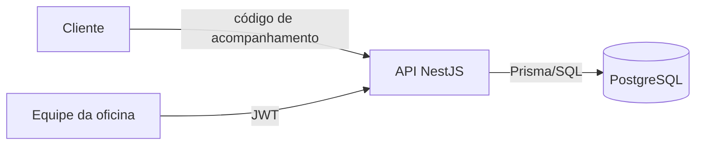

# Visão arquitetural

## HLD

O sistema é um monólito modular NestJS acessado por dois perfis: cliente, por rotas públicas protegidas pelo código de acompanhamento; e equipe da oficina, por APIs administrativas protegidas por JWT. A API REST documentada em Swagger persiste dados no PostgreSQL por meio do Prisma.

Implantação local: contêiner da aplicação e PostgreSQL orquestrados por Docker Compose. Consulte [c4.md](c4.md).

## LLD

Cada módulo separa:

- `apresentacao`: controllers, DTOs, validação e contrato HTTP;
- `aplicacao`: casos de uso, portas de repositório e saídas;
- `dominio`: entidades, objetos de valor, enums e invariantes;
- `infraestrutura`: adaptadores Prisma e JWT.

`src/aplicacao.module.ts` compõe Autenticação, Acompanhamento, Clientes, Veículos, Ordens de Serviço, Serviços, Peças/Insumos, Indicadores e Banco de Dados no mesmo processo.

Fluxos críticos:

1. Abertura valida cliente, propriedade/placa e persiste veículo e OS de forma transacional.
2. Composição captura snapshots de preços e quantidades durante o diagnóstico.
3. Aprovação bloqueia a OS, valida saldo, baixa todos os itens, decide o orçamento e inicia a execução na mesma transação.
4. Rejeição não altera estoque e devolve a OS ao diagnóstico.
5. Finalização registra o término; o indicador usa início/fim e composição persistidos.

## Limites

- Sem mensageria, cache distribuído, integrações externas ou microsserviços.
- Eventos de domínio são mudanças de estado documentadas, não mensagens publicadas.
- O PostgreSQL é compartilhado pelos contextos lógicos do monólito.
